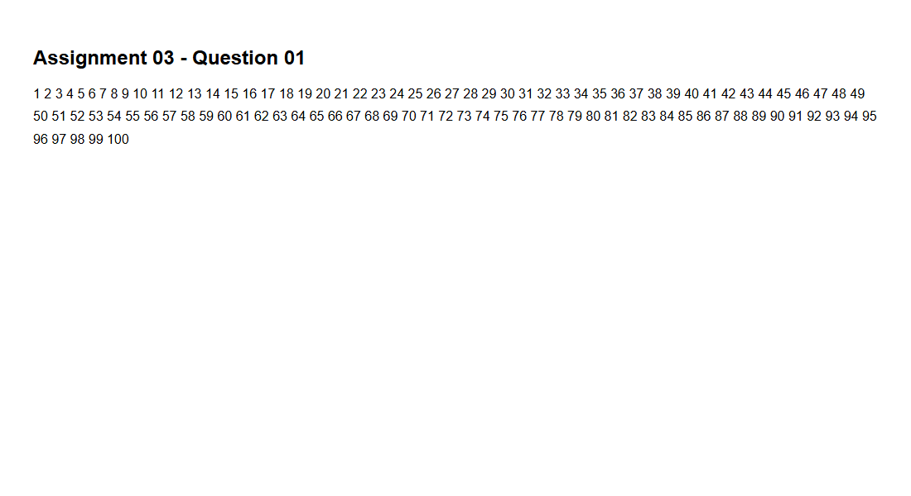
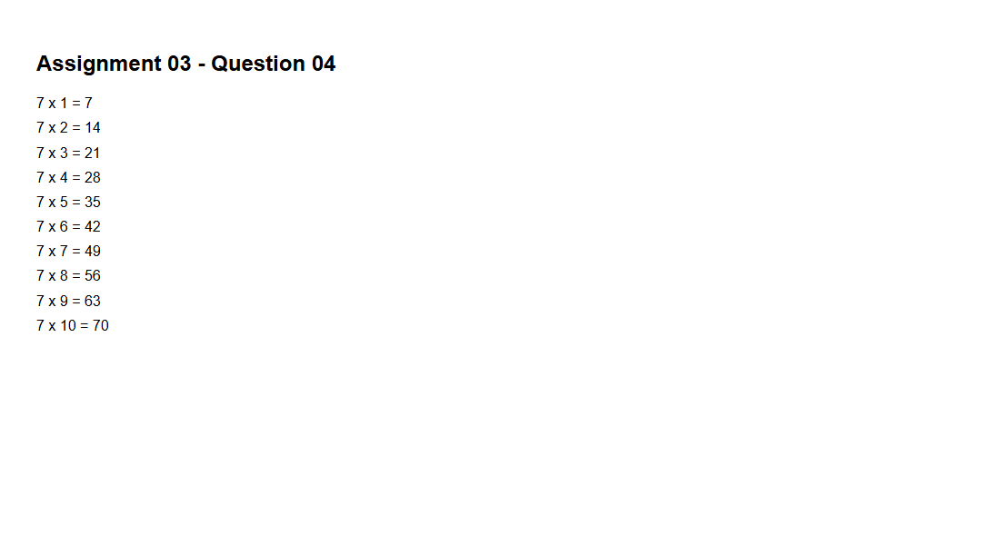
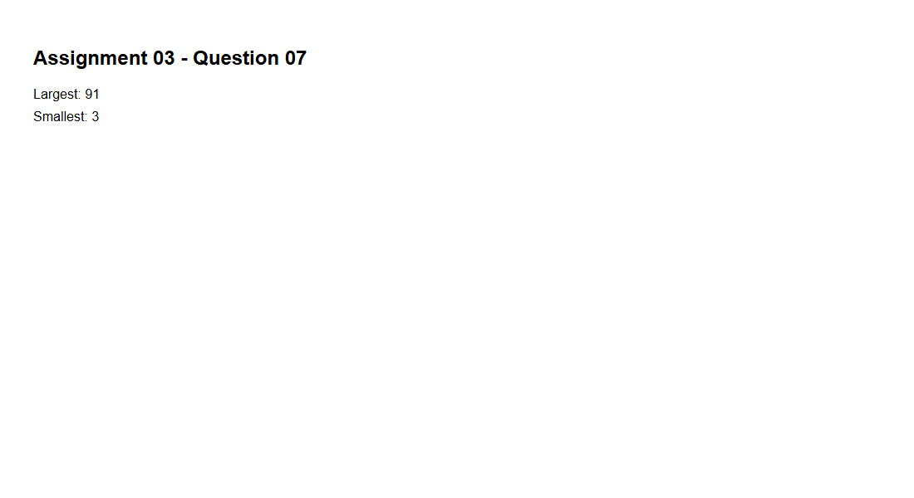
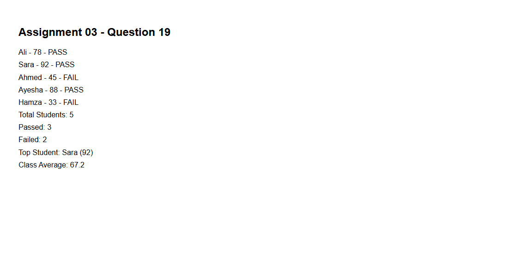
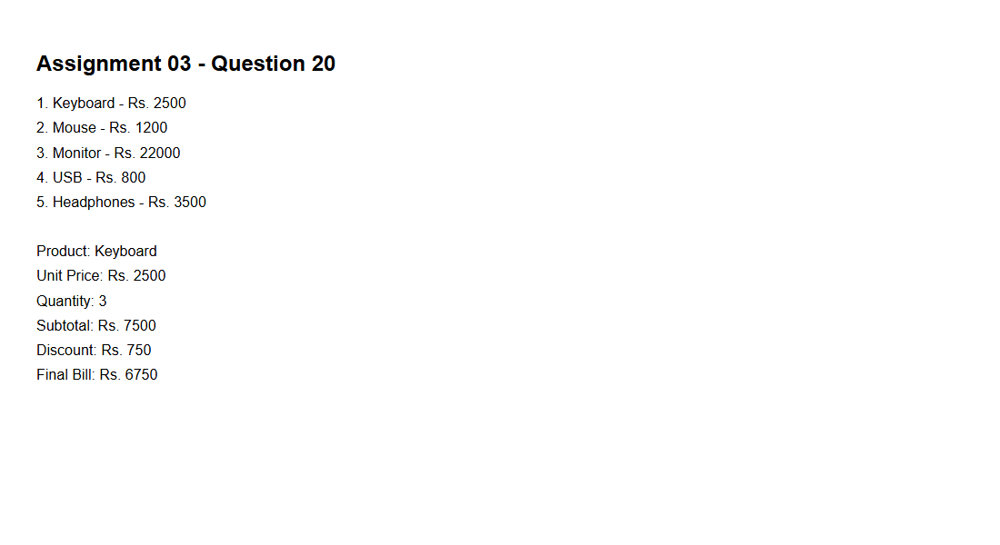

# JavaScript Assignment 03

- **Student name:** Muhammad Hussain Khan Lodhi
- **Student ID:** 829336
- **Batch:** SMIT Batch 22
- **Trainer:** Sir Jaffar Aman
- **Course:** Web & Mobile App Development

## Run my work

Open the parent `index.html` of Assignment no.3 and click a question. Its folder page loads that question JavaScript and displays the output.

## Screenshots

    

## Submission

Public GitHub repository: https://github.com/MuhammadHussain2004/SMIT-Batch22-JS-Assignments
